# 🎬 Streaming Platform — Complete Architecture Walkthrough (Interview Ready)

> This document walks you through the **entire project architecture** — how a user interacts with it, what happens at every layer, and the technical decisions behind each feature. Use this to explain your project confidently in any interview.

---

## 📌 One-Liner Pitch

> "I built a **production-grade backend for a video streaming platform** (like YouTube's API layer) using **Node.js, Express, MongoDB, and Cloudinary**, with three AI-powered features: thumbnail suggestions via Gemini, transcription via local Whisper, and a multi-strategy recommendation engine."

---

## 🏗️ High-Level Architecture

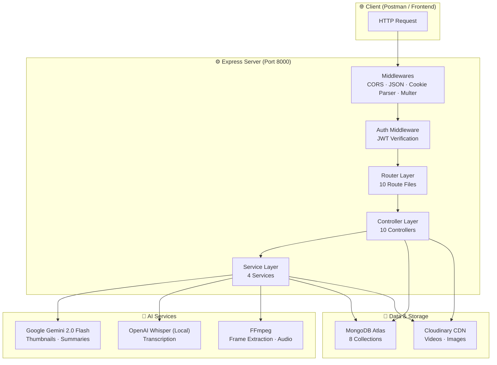

---

## 📂 Project Structure — What Each Folder Does

```
streaming_platform/
├── src/
│   ├── index.js              ← Entry point: loads .env, connects DB, starts server
│   ├── app.js                ← Express app: middlewares + all 10 route mounts
│   ├── constant.js           ← DB_NAME constant
│   ├── db/index.js           ← MongoDB Atlas connection with mongoose
│   ├── models/               ← 8 Mongoose schemas (User, Video, Transcript, etc.)
│   ├── controllers/          ← 10 controller files (business logic)
│   ├── services/             ← 4 service files (AI pipelines, recommendations)
│   ├── routes/               ← 10 route files (endpoint definitions)
│   ├── middlewares/           ← Auth (JWT verification) + Multer (file uploads)
│   └── utils/                ← ApiError, ApiResponse, asyncHandler, Cloudinary
├── scripts/
│   ├── transcribe.py         ← Python Whisper script (called from Node via spawn)
│   └── test_apis.sh          ← Shell script to test all endpoints
├── .venv/                    ← Python virtual environment for Whisper
├── public/temp/              ← Temporary files during processing (auto-cleaned)
└── .env                      ← All secrets (Mongo, JWT, Cloudinary, Gemini)
```

---

## 🚀 The User Journey — Step by Step

### 🔵 Step 1: Server Starts

> "When I run `npm run dev`, here's what happens..."

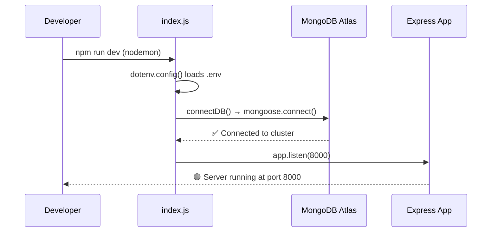

**What happens internally:**
1. [`index.js`](file:///Users/jeel/Desktop/streaming_platform/src/index.js) loads environment variables via `dotenv`
2. Calls [`connectDB()`](file:///Users/jeel/Desktop/streaming_platform/src/db/index.js) — an async function that connects to MongoDB Atlas using `mongoose.connect()`
3. On success, starts Express on port 8000
4. On failure, exits with `process.exit(1)` — fail-fast pattern

**Interview point:** *"The DB is on another continent, so every DB call is async/await. I separated the DB connection into its own module for clean organization."*

---

### 🔵 Step 2: Request Hits the Server

Every request passes through this middleware chain in [`app.js`](file:///Users/jeel/Desktop/streaming_platform/src/app.js):

| Order | Middleware | Purpose |
|-------|-----------|---------|
| 1 | `cors()` | Allows cross-origin requests. `credentials: true` so cookies work. |
| 2 | `express.json({ limit: "16kb" })` | Parses JSON bodies, caps at 16KB to prevent abuse. |
| 3 | `express.urlencoded({ extended: true })` | Parses form data. |
| 4 | `express.static("public")` | Serves static files (temp frames, etc.). |
| 5 | `cookieParser()` | Parses cookies so we can read JWT tokens from `req.cookies`. |

Then the request is routed to one of **10 route modules**, all prefixed with `/api/v1/`:

| Route Prefix | Module | Auth? |
|-------------|--------|-------|
| `/api/v1/users` | User CRUD, Auth | Mixed |
| `/api/v1/videos` | Video CRUD | ✅ |
| `/api/v1/comments` | Comments | ✅ |
| `/api/v1/likes` | Like/Unlike | ✅ |
| `/api/v1/playlists` | Playlist CRUD | ✅ |
| `/api/v1/tweets` | Community posts | ✅ |
| `/api/v1/subscriptions` | Subscribe/Unsubscribe | ✅ |
| `/api/v1/ai` | AI Thumbnails | ✅ |
| `/api/v1/ai/transcripts` | Transcription + Search | ✅ |
| `/api/v1/recommendations` | Trending, For-You, Similar, Feed | Mixed |

---

### 🔵 Step 3: User Registers → `POST /api/v1/users/register`

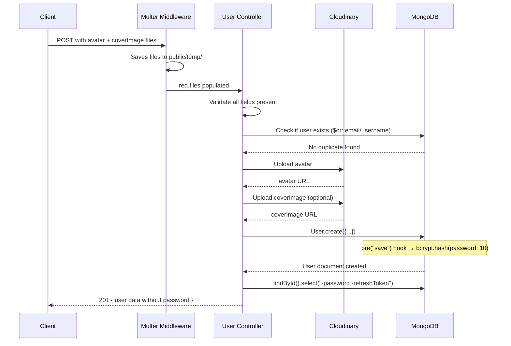

**Key technical details:**

1. **Multer middleware** ([`multer.middleware.js`](file:///Users/jeel/Desktop/streaming_platform/src/middlewares/multer.middleware.js)) — handles `multipart/form-data`, saves files to `public/temp/` before uploading to Cloudinary
2. **Validation** — checks all fields are non-empty using `.some(field => field?.trim() === "")`
3. **Duplicate check** — `User.findOne({ $or: [{ email }, { username }] })` — checks BOTH in one query
4. **Cloudinary upload** ([`cloudinary.js`](file:///Users/jeel/Desktop/streaming_platform/src/utils/cloudinary.js)) — uploads with `resource_type: "auto"`, then **deletes the local file** via `fs.unlinkSync()`
5. **Password hashing** — Mongoose `pre("save")` hook on the User model automatically hashes with bcrypt (salt round 10) before saving. Only triggers if `this.isModified("password")` — so updating email won't re-hash.
6. **Response** — returns user data WITHOUT password and refreshToken using `.select("-password -refreshToken")`

---

### 🔵 Step 4: User Logs In → `POST /api/v1/users/login`

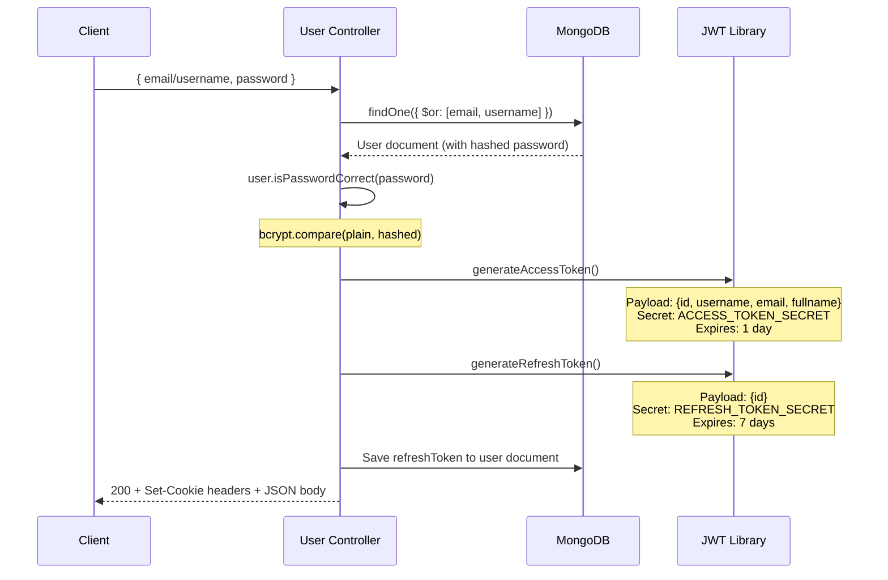

**The Dual JWT System:**

| Token | Purpose | Lifetime | Storage | Payload |
|-------|---------|----------|---------|---------|
| **Access Token** | Authenticate each API request | 1 day | HttpOnly Cookie + JSON body | `{ id, username, email, fullname }` |
| **Refresh Token** | Get a new access token without re-login | 7 days | HttpOnly Cookie + DB | `{ id }` only |

**Cookie security options:**
```javascript
{
    httpOnly: true,     // JavaScript can't access → prevents XSS
    secure: true,       // Only sent over HTTPS (in production)
    sameSite: "strict", // Not sent in cross-site requests → prevents CSRF
    maxAge: 7 * 24 * 60 * 60 * 1000  // 7 days
}
```

**Interview point:** *"Why two tokens? The access token is short-lived so if it leaks, the damage window is small. The refresh token is long-lived but stored as HttpOnly cookie — JavaScript can never access it, so XSS attacks can't steal it. And I store the refresh token in the DB too — on every refresh, I compare the incoming token with what's in the DB. If they don't match, someone may have stolen the old one, so I reject it."*

---

### 🔵 Step 5: Auth Middleware Protects Routes

Every protected route passes through [`verifyJWT`](file:///Users/jeel/Desktop/streaming_platform/src/middlewares/auth.middleware.js):

```
Request → Extract token (cookie OR Authorization header) → jwt.verify() → Find user in DB → Attach to req.user → next()
```

**It checks two places for the token:**
1. `req.cookies.accessToken` — for browser/cookie-based clients
2. `req.header("Authorization").replace("Bearer ", "")` — for mobile/Postman clients

If valid, the **entire user document** (minus password & refreshToken) is attached to `req.user` — so every downstream controller has user info without another DB query.

---

### 🔵 Step 6: Token Refresh Flow → `POST /api/v1/users/refresh-token`

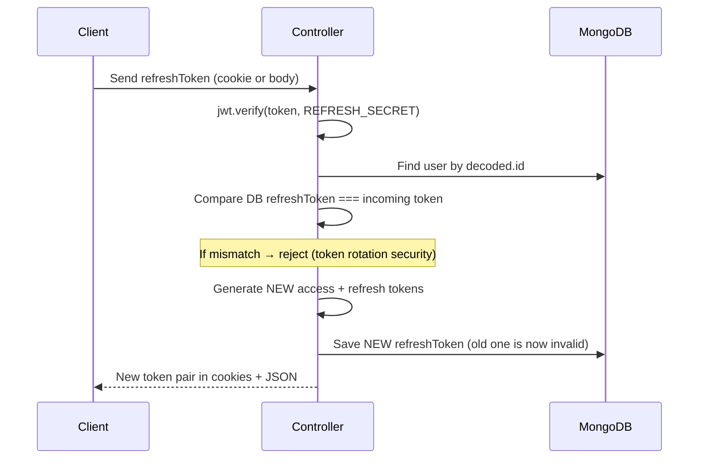

**This is single-use rotation** — the old refresh token becomes invalid after use. If an attacker replays it, the comparison fails.

---

### 🔵 Step 7: User Logs Out → `POST /api/v1/users/logout`

1. `$unset: { refreshToken: 1 }` — removes the field from the DB entirely
2. Clears both cookies with `maxAge: 0` — browser immediately deletes them
3. Even if someone has the old tokens, they won't work because:
   - Access token will expire naturally (1 day max)
   - Refresh token is gone from DB — comparison will fail

---

## 🎥 Core Features — How Each One Works

### Feature 1: Video Upload & Management

**Upload:** `POST /api/v1/videos`

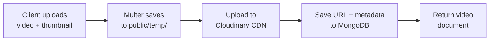

- Videos and thumbnails go to Cloudinary (CDN) — not stored on server
- Duration comes from Cloudinary's response (`videoFile.duration`)
- Tags are parsed from comma-separated string or JSON array
- `ispublished: true` by default — owner can toggle

**View video:** `GET /api/v1/videos/:videoId`
- Atomically increments `views` with `$inc: { views: 1 }`
- Adds to user's `watchHistory` with `$addToSet` (no duplicates)
- Returns video with owner details + like count + `isLiked` flag — all in **one aggregation pipeline**

**Delete video:** Full cascade cleanup:
```
Cloudinary: destroy video (resource_type: "video") + destroy thumbnail (image)
MongoDB: Comment.deleteMany + Like.deleteMany + User.updateMany($pull watchHistory)
MongoDB: Video.findByIdAndDelete
```
*"No orphaned data anywhere — not on the CDN, not in the database."*

---

### Feature 2: Channel Profile (MongoDB Aggregation Pipeline)

`GET /api/v1/users/c/:username` — Uses a **5-stage aggregation pipeline:**

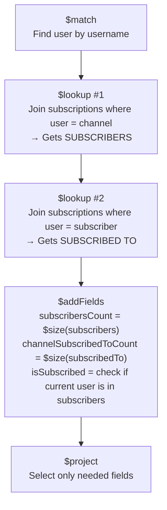

**Interview point:** *"I used two lookups on the SAME subscriptions collection but with different join conditions — `foreignField: 'channel'` gives me subscribers, `foreignField: 'subscriber'` gives me who I'm subscribed to. And `$addFields` with `$in` checks if the current viewer is subscribed, so the frontend can show the subscribe/unsubscribe button."*

---

### Feature 3: Watch History (Nested Aggregation)

`GET /api/v1/users/watch-history` — **Sub-pipeline inside $lookup:**

```
User → $lookup videos (from watchHistory array)
         └── Inside that: $lookup users (get video owner)
              └── $project only fullname, username, avatar
         └── $addFields: owner = $first of owner array
```

**Why `new mongoose.Types.ObjectId(req.user._id)`?** — In aggregation pipeline, Mongoose doesn't auto-cast strings to ObjectIds like it does in `findById()`. We have to manually convert.

---

## 🤖 AI Feature 1: Thumbnail Suggestions

### Pipeline Overview

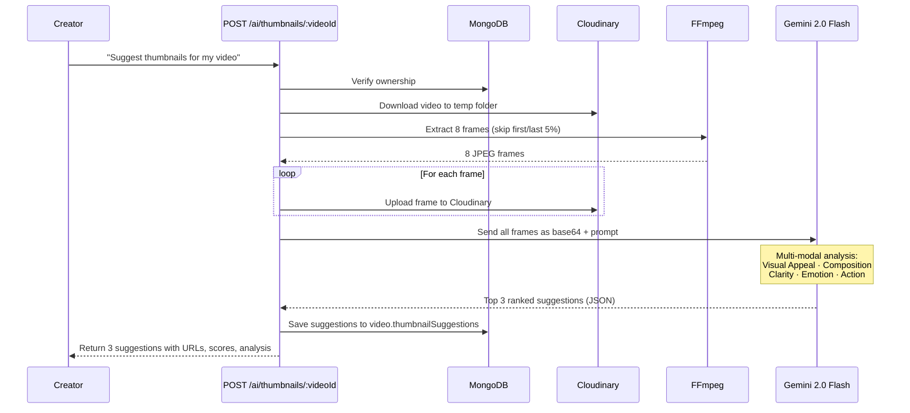

### Technical Deep Dive

| Step | What Happens | Code Location |
|------|-------------|---------------|
| Download | `http.get()` with redirect handling | [`thumbnail.service.js`](file:///Users/jeel/Desktop/streaming_platform/src/services/thumbnail.service.js#L21-L52) |
| Frame extraction | Skip first/last 5% duration, extract N evenly-spaced frames | [`thumbnail.service.js`](file:///Users/jeel/Desktop/streaming_platform/src/services/thumbnail.service.js#L62-L112) |
| Frame count | `<30s → 5 frames`, `<120s → 8 frames`, `else → 10 frames` | [`thumbnail.service.js`](file:///Users/jeel/Desktop/streaming_platform/src/services/thumbnail.service.js#L193) |
| Gemini prompt | Multi-modal: text + all images as base64 `inlineData` | [`gemini.service.js`](file:///Users/jeel/Desktop/streaming_platform/src/services/gemini.service.js#L24-L91) |
| Response format | `responseMimeType: "application/json"` forces structured output | [`gemini.service.js`](file:///Users/jeel/Desktop/streaming_platform/src/services/gemini.service.js#L9) |
| Cleanup | `finally` block deletes all temp files even if errors occur | [`thumbnail.service.js`](file:///Users/jeel/Desktop/streaming_platform/src/services/thumbnail.service.js#L262-L265) |

**Apply a suggestion:** `PATCH /ai/thumbnails/:videoId` — Deletes old thumbnail from Cloudinary, sets the chosen frame URL as the new thumbnail.

---

## 🤖 AI Feature 2: Video Transcription

### Pipeline Overview

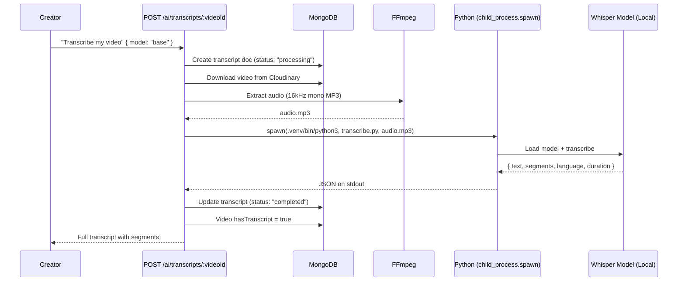

### The Node ↔ Python Bridge

```javascript
// Node.js spawns a Python child process
const childProcess = spawn(VENV_PYTHON, [TRANSCRIBE_SCRIPT, audioPath, "--model", model]);

// Capture stdout (transcript JSON) and stderr (errors) separately
childProcess.stdout.on("data", (data) => stdout += data.toString());
childProcess.stderr.on("data", (data) => stderr += data.toString());

// On exit, parse the JSON output
childProcess.on("close", (code) => {
    const result = JSON.parse(stdout);  // ← This is the transcript
});
```

**Why Whisper locally instead of OpenAI API?**
- **Cost:** Zero per-minute cost (free forever)
- **Privacy:** Audio never leaves the server
- **Flexibility:** Choose model size — `tiny` for speed, `large` for accuracy

### Transcript Search: `GET /ai/transcripts/search?q=keyword`

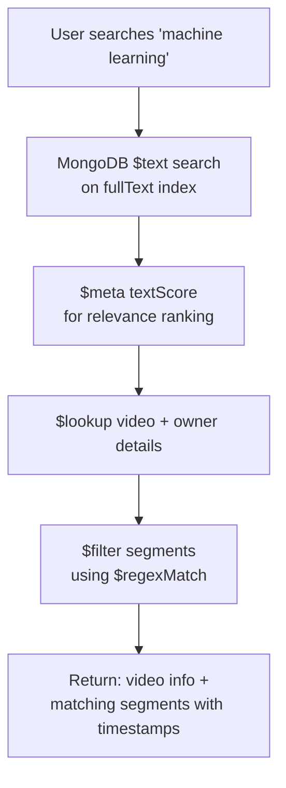

This is like **YouTube's search-within-video** — you search a word and get the exact timestamp where it appears.

### AI Summary: `POST /ai/transcripts/:videoId/summary`

Chains the transcript into Gemini to generate:
- **Summary** (2-4 sentences)
- **Key Topics** (3-7 topics)
- **Chapter Markers** (timestamp + title) — like YouTube chapters

---

## 🤖 AI Feature 3: Recommendation Engine

### 4 Strategies

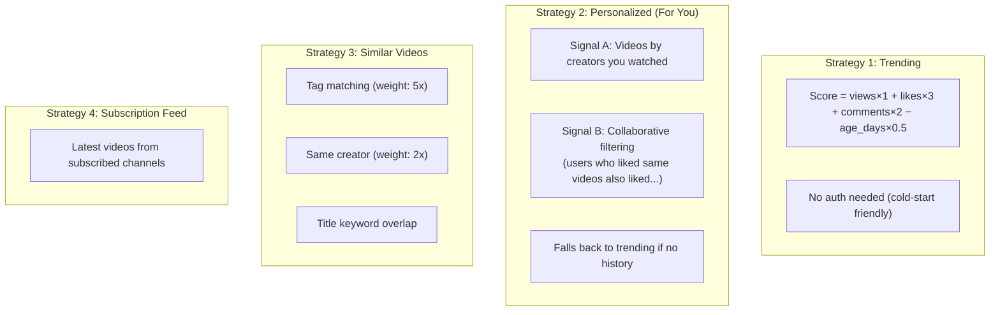

### Trending Score Formula

```
trendingScore = (views × 1.0) + (likes × 3.0) + (comments × 2.0) − (ageInDays × 0.5)
```

| Weight | Reasoning |
|--------|-----------|
| Views × 1.0 | Passive engagement — lowest signal |
| Likes × 3.0 | Intentional action — strongest signal |
| Comments × 2.0 | Active engagement — strong signal |
| Age × -0.5 | Decay — fresh content can surface even with fewer views |

### Collaborative Filtering (Personalized Feed)

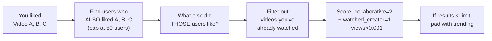

**Interview point:** *"The cap of 50 similar users prevents expensive fan-out queries. And if personalized results are too few — like a new user who has only watched 2 videos — I pad the remaining slots with trending so the page is never empty."*

---

## 🛡️ Error Handling Architecture

### The Three Layers

| Layer | Implementation | File |
|-------|---------------|------|
| **Custom Error Class** | `ApiError extends Error` with statusCode, errors array | [`ApiError.js`](file:///Users/jeel/Desktop/streaming_platform/src/utils/ApiError.js) |
| **Async Wrapper** | `asyncHandler` wraps every controller — catches Promise rejections, calls `next(err)` | [`asyncHandler.js`](file:///Users/jeel/Desktop/streaming_platform/src/utils/asyncHandler.js) |
| **Global Error Handler** | Last middleware in Express — converts `ApiError` to JSON | [`app.js`](file:///Users/jeel/Desktop/streaming_platform/src/app.js#L41-L52) |

```javascript
// Every controller is wrapped:
const myController = asyncHandler(async (req, res) => {
    // If this throws, asyncHandler catches it and passes to global error handler
    throw new ApiError(400, "Bad request");
});

// Global handler at the bottom of app.js:
app.use((err, req, res, next) => {
    res.status(err.statusCode || 500).json({
        success: false,
        message: err.message,
        errors: err.errors,
        stack: process.env.NODE_ENV !== "production" ? err.stack : undefined
    });
});
```

**Interview point:** *"I never use try-catch in controllers. The asyncHandler utility wraps every controller in Promise.resolve().catch(next), so any thrown error — whether it's my ApiError or an unhandled rejection — automatically flows to the global error handler. It keeps every controller clean and consistent."*

---

## 📊 Data Models — Schema Design

### 8 Collections

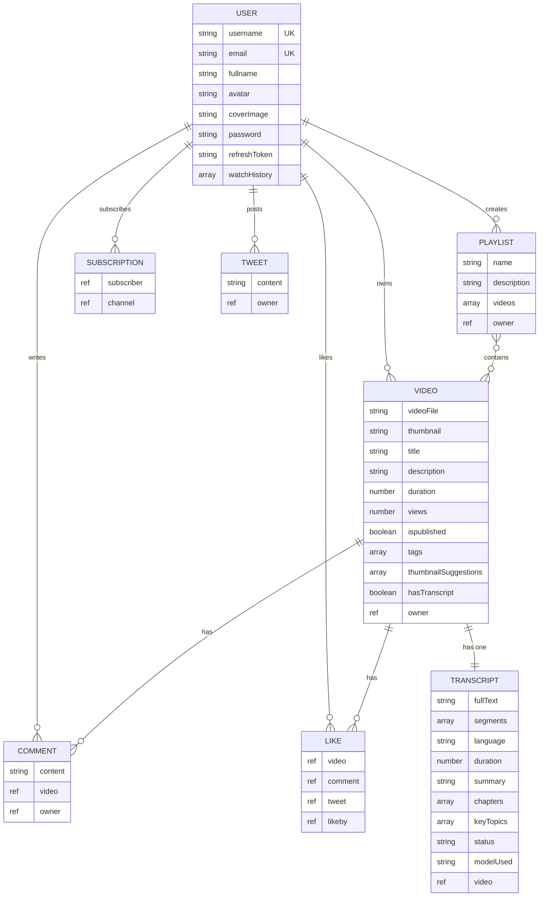

### Key Design Decisions

| Decision | Reasoning |
|----------|-----------|
| **Like model is polymorphic** — has `video`, `comment`, AND `tweet` fields | One Like model handles all like-able entities. Only one of the three refs is set per document. |
| **watchHistory is an array in User** | Using `$addToSet` for dedup. If it grew huge, you'd move to a separate collection. |
| **Transcript is a separate collection** (not embedded in Video) | Transcripts can be huge (thousands of segments). Separate collection means full-text index works natively. |
| **thumbnailSuggestions embedded in Video** | Small, bounded array (max 3 items). No need for a separate collection. |
| **mongoose-aggregate-paginate-v2** on Video & Comment | Enables cursor-based pagination on aggregation pipelines — essential for infinite scroll. |

---

## 🔧 Utility Patterns

### Standardized API Response

```javascript
// Every success response follows this structure:
class ApiResponse {
    constructor(statusCode, data, message = "Success") {
        this.statusCode = statusCode;
        this.data = data;
        this.message = message;
        this.success = statusCode < 400;
    }
}
```

### Cloudinary Upload + Local Cleanup

```javascript
const uploadOnCloudinary = async (localFilePath) => {
    const response = await cloudinary.uploader.upload(localFilePath, {
        resource_type: "auto"  // auto-detect: image, video, raw
    });
    fs.unlinkSync(localFilePath);  // ← Always clean up local file
    return response;
};
```

If upload fails, the `catch` block still deletes the local file — no orphaned temp files.

---

## 💡 What I'd Add for Production (Scaling Answers)

| Concern | Solution |
|---------|----------|
| AI pipelines blocking API | **BullMQ** job queue — thumbnail & transcription jobs run asynchronously |
| Repeated recommendation queries | **Redis** caching with TTL for trending & personalized feeds |
| Whisper is CPU-intensive | Move to a **separate worker service** that scales independently |
| Video processing at scale | **AWS Lambda** or **Cloud Functions** for frame extraction |
| Real-time features | **Socket.io** for live comments, notifications |
| Search at scale | **Elasticsearch** instead of MongoDB `$text` for better full-text search |

---

## 🗣️ How to Present This in an Interview

### Opening (30 seconds)
> "I built a production-grade backend for a video streaming platform using Node.js, Express, MongoDB, and Cloudinary. It handles the full lifecycle — auth, video upload, social features — plus three AI features that go beyond basic CRUD."

### Walk Through the Journey (2-3 minutes)
> "When a user hits the server, the request goes through CORS, JSON parser, cookie parser. If the route is protected, the JWT auth middleware verifies the token — checks cookies first, then Authorization header. The User model handles password hashing via a pre-save hook with bcrypt, and token generation is built into the schema methods."

### Highlight What's Interesting (2-3 minutes)
> "But what makes this project stand out are three things..."
> 1. **AI Thumbnails** — FFmpeg extracts frames, Gemini analyzes them multi-modally
> 2. **Local Whisper Transcription** — Node spawns a Python process, captures JSON from stdout
> 3. **4-Strategy Recommendation Engine** — trending with decay scoring, collaborative filtering, tag-based similarity, subscription feed

### Handle Follow-ups
Use the deep-dive sections above for questions about:
- Auth/security → Dual JWT + token rotation + HttpOnly cookies
- Data modeling → Why certain schemas are embedded vs referenced
- Scaling → Job queues, Redis, separate workers
- Error handling → asyncHandler + global error handler pattern
- Why MongoDB → Document-oriented data, aggregation pipelines for recommendations

---

> [!TIP]
> **Practice saying these flows out loud.** The best candidates don't just know the code — they can narrate the request journey like a story. Start with "when a user does X" and walk through each layer.
